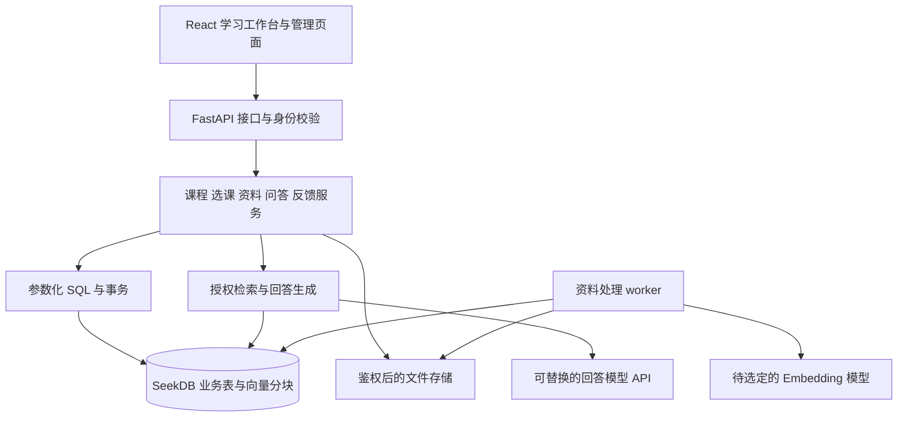

# 课程学习助手技术架构初稿

前端使用 React，后端使用 Python FastAPI。首版按模块组织一个后端应用，另启用同代码仓库的资料处理 worker；SeekDB 承担关系数据和向量数据。大模型供应商和具体模型保持待定，不阻塞业务开发。

## 系统分层

| 位置 | 职责 |
| --- | --- |
| `frontend/src/pages` | 登录、课程、工作台、资料、历史、设置页面 |
| `frontend/src/components` | 资料列表、问答消息、引用面板、错误和处理状态 |
| `frontend/src/api` | 请求封装与类型；不直接访问数据库或持有模型密钥 |
| `backend/app/api` | 请求解析、身份注入、统一错误响应 |
| `backend/app/services` | 业务规则、权限、事务边界 |
| `backend/app/repositories` | SQL、连接管理、查询与锁操作 |
| `backend/app/rag` | 分块、Embedding 接口、授权检索、生成和引用校验 |
| `backend/app/workers` | 任务领取、解析、向量生成、发布和重试 |
| `backend/app/core` | 配置、认证、密码哈希、日志与错误定义 |
| `sql` | 手写建表、种子数据、关键查询和演示事务 |
| `evals` | 评测集、评分规则、运行配置与结果 |
| `docs` | 产品、架构、数据库和验收材料 |

以上是完整目标目录。当前已实现 API、core、课程与资料 services、文件校验与分块模块 documents、解析 worker 和 React 界面；repositories 尚未单独拆分，SQL 暂位于服务层及队列模块。向量化与 RAG 尚未实现。

## 技术选择与待定项

| 项目 | 当前决定 |
| --- | --- |
| 前端 | React + TypeScript + Vite + React Router；组件库及样式方案待页面设计时确定 |
| 后端 | FastAPI；建议隔离 Python 3.12 环境，具体依赖锁定后验证 |
| 数据访问 | PyMySQL 和手写参数化 SQL，业务与向量操作经过统一模块 |
| 数据库 | 优先 SeekDB Server + Docker 命名卷；先验证再固定镜像版本，不依赖 latest 重现 |
| 文件 | 受控本地文件目录；元信息及所有权存数据库 |
| 文件依赖 | python-multipart 处理表单，pypdf 校验文本型 PDF；TXT 和 Markdown 使用 UTF-8 校验 |
| 登录 | 建议短时 JWT 放入 HttpOnly Cookie；状态与业务资格每次在后端检查，写请求校验 CSRF/来源，生产 HTTPS |
| Embedding | 优先尝试本地中文模型；BGE-small-zh-v1.5 是候选，尚未锁定 |
| 回答模型 | 云端付费 API，供应商与模型在真实问题评测后选择；Qwen 是候选而非决定 |
| RAG 编排 | 用清晰的 Python 流程函数实现，首版不引入额外编排框架 |
| 测试 | pytest + 真实 SeekDB 集成测试 + 浏览器关键流程验证 |

PyMySQL 是数据库驱动，不是另部署一个 MySQL。课程实验 0 可使用 pyseekdb Collection API 入门；综合项目的关系表、建表 SQL 和事务不能被 metadata 代替。

如果实际验证发现所选 SeekDB 版本不能满足必要 SQL/约束能力，先定位兼容问题；需要改为关系型 DBMS 加 SeekDB 的方案时，应按实验要求取得教师认可并重新说明同步设计。

## 资料入库

1. 后端校验用户、课程权限、文件大小、扩展名与内容类型；文件名和上传声明不能单独作为类型依据。
2. 原文件保存到受控目录，资料与处理任务持久化。返回资料编号及“处理中”。
3. worker 领取有租约的任务，提取正文和页码/标题，识别空文本与不支持的文件。
4. 根据段落及标题分块，超过模型输入限制时继续拆分，保存必要重叠。分块大小按 Embedding tokenizer 的上限确定，不以固定中文字数代替 Token 限制。
5. 计算向量；同一发布版本使用相同模型、维度和归一化配置。
6. 短事务校验任务租约、资料状态与版本，原子发布全部分块并将资料改为 READY。
7. 出错记录可解释的错误码；达到有限重试次数后标记失败，用户可以手动重试。成功、失败和续租写回统一校验版本、任务状态、有效租约与 worker_token；迟到的失败不能覆盖新 worker 已发布的成功。手动重试原子转换当前版本任务与资料状态，递增重试轮次并作废旧 token。

worker 使用持久化任务和过期租约恢复；不能只靠 FastAPI 进程内后台任务保证重启后继续执行。外部模型请求和长时间文件处理不能持有数据库行锁。

当前实际运行流程止于 PARSED：解析结果原子保存但不发布为可检索。所有队列写入统一按课程、资料、任务顺序加锁，并检查当前版本、租约和令牌。分块预处理采用字符上限，真实 Embedding 接入前还要按 tokenizer 检查，详见 [解析阶段记录](verification/milestone-03.md)。

## 问答与检索授权

1. 由后端确认当前账号和课程，并检查有效选课或授课关系。
2. 查询当前可访问、READY、未删除的资料及其当前版本分块。
3. 在这个授权候选集合内部调用 SeekDB 向量距离查询并取 Top-K。SQL 条件或候选 ID 必须由后端生成，并参数绑定；不能接收前端提供的任意 owner_id 作为权限。
4. 只有授权片段可以进入模型上下文、引用返回值和可见日志。不能先全库 Top-K 再删除他人资料，混合检索的每一条检索路径也必须带相同权限限制。
5. 向量相关性阈值及 Top-K 通过评测确定，不能把距离分数直接称为“答案正确概率”。没有足够依据时提示资料不足。
6. 模型基于提供的资料回答，以服务端分配的片段标识引用。资料正文视为数据，不接受文档中要求读取其他用户文件、修改权限或执行工具的指令。
7. 服务端检查引用编号是否来自本次授权候选；有资料依据的成功答案至少包含一条有效引用。格式或编号不合法时返回受控失败，不能把无效引用当作可核对答案。引用支持结论的语义准确性仍要人工评测。
8. 保存 Top-K 的排名与分数，并明确标记上下文裁剪后实际发送的片段。保存和返回答案前再次验证全部实际发送片段的资格、资料状态和版本，不能只检查模型标出的引用；发现变化则丢弃本次答案并提示重试。
9. 写入答案、证据和实际可得的耗时/用量；读取历史时再次检查全部实际发送片段的权限和版本。引用是证据的展示子集，不能代替答案依赖清单。

首版小数据集优先验证带授权条件的精确向量查询。确有性能需求后再评测 ANN 或混合检索，不能为性能省略候选权限限制。

## 模型调用边界

定义两种独立接口：`EmbeddingProvider.embed(texts)` 和 `AnswerProvider.generate(question, evidence, config)`。供应商 SDK 和异常转换封装在适配层，业务服务不散落具体模型调用代码。

回答模型可配置供应商、模型/快照、地址、超时、输出上限和重试策略。保留模型版本及提示词版本用于评测复现。更换 Embedding 模型时需重建相应文档和查询向量，禁止不同向量空间混用。

前期允许用确定性的模拟响应验证界面和业务状态，必须明确显示开发模拟模式，且不得用模拟数据作为智能检索验收结果。真正的 RAG 验收必须有 SeekDB 向量检索和实际模型回答。

每次模型调用和重试都记录在 qa_messages.model_calls 中，包含结果、耗时、请求编号、模型快照、区域、单价及价格版本、实际 Token 与估算费用；供应商没有返回的用量标记未知。汇总用量标注是否完整，不能将估算或不完整费用当作最终账单。实际 Top-K、排名、分数和上下文选入情况由 answer_evidence 保存，支持复核检索命中指标。

小额预算先由调用次数、输入/输出上限、有限重试和用户限流约束，再结合供应商可用的预算控制。预算数额待用户决定，本轮不开户、不充值、不配置密钥。

## 接口约定

- API 前缀 `/api/v1`，统一错误结构：`code`、`message`、`request_id`。
- 无有效登录返回 401；有身份但无课程操作权限返回 403；无权获知其存在的私有资料/会话可统一返回 404。
- 不存在返回 404；重复选课、容量冲突、正文版本冲突、引用版本变化等返回 409。
- 不合规文件返回 413/415 或具体校验错误；参数校验失败返回 422。
- 上游限流、超时及模型故障转换为清晰的可重试错误；不将密钥、供应商完整原始报错或服务器路径返回前端。
- 所有列表分页。登录与问答设置频率限制。跨用户的资料、消息、下载和反馈均检查对象所有权。
- 问答提交使用服务端记录的会话内幂等请求键；同键不同问题返回冲突，重复点击或网络重发返回已有状态。查找记录之前先验证会话所有权。
- 生成设置有限截止时间。进程重启或超时遗留的 PROCESSING 问答转为 FAILED，用户显式重试使用新请求键，不无限等待或自动重新计费。上游重试另记尝试次数，外部服务是否已经计费需要用量或账单核对。

## 首轮技术验证

已在 Python 3.13.9、Node.js 22.21.0 与 Docker Desktop 上运行本阶段代码。Docker 引擎已启动，SeekDB 1.4.0 已部署并固定镜像摘要；具体结果见 [阶段验证记录](verification/milestone-01.md)。Python 3.12 是兼容目标，尚未在本机单独运行验证。

首轮技术验证项如下；已验证约束、回滚、并发、合成向量授权过滤与重启持久化，完整资料删除/替换/退课后的 RAG 行为仍待业务实现后测试：

1. 固定 SeekDB 镜像可启动，命名卷重启后数据仍在。
2. 主键、唯一约束和外键确实拦截非法数据，CHECK 的实际支持行为明确。
3. BEGIN/COMMIT/ROLLBACK 正确；并发最后名额与容量调整不超卖。
4. 通过 PyMySQL 的参数化向量查询可以在授权片段内排序，语法、维度和返回结果稳定。
5. 删除、替换、退课后，候选范围立刻变化；不能依赖可能滞后的向量 metadata。

## 官方参考

- SeekDB SQL 与部署入口：https://github.com/oceanbase/seekdb
- Python SDK 与 SQL 驱动分工：https://oceanbase.github.io/pyseekdb/
- Docker 镜像说明：https://github.com/oceanbase/docker-images/blob/main/seekdb/README.md
- FastAPI：https://fastapi.tiangolo.com/
- React：https://react.dev/
