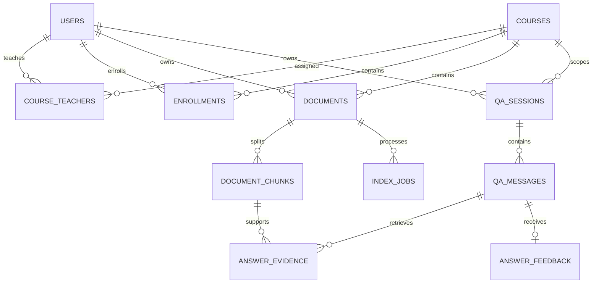

# 课程学习助手数据库设计初稿

版本：0.4。使用一个 SeekDB 数据库管理关系数据和向量。11 张业务表、任务阶段/审计迁移和正式 1024 维 embedding 列已在 SeekDB 1.4.0 验证。资料解析与单份向量发布 worker 已实现；使用精确向量排序，尚未增加 ANN 向量索引，问答仍是目标设计。

## ER 图

所有业务编号使用 BIGINT 主键；字符串使用 utf8mb4；时间统一保存 UTC，界面显示 Asia/Shanghai。SQL 使用参数绑定，动态排序字段等通过服务端白名单选择。

## 表与关键字段

### users 用户

- `id`：主键。
- `username`：登录名，非空、唯一；账号创建时规范化。
- `password_hash`：密码哈希，禁止存储明文密码。
- `display_name`、`role`（STUDENT / TEACHER）、`status`（ACTIVE / DISABLED）。
- `created_at`、`updated_at`。

角色管理首版通过初始化数据完成。课程相关权限仍需查询授课或选课关系，不能只检查角色。

### courses 课程

- `id`：主键；`code`：唯一课程开课编号，不同学期使用不同编号。
- `name`、`description`、`capacity`：容量必须为正整数。
- `enrollment_status`：OPEN / CLOSED，控制是否可新增选课。
- `created_by`：外键指向 users。
- `created_at`、`updated_at`。

不冗余保存已选人数；从有效 enrollments 聚合计算，避免额外维护计数。容量变更与选课必须锁定同一课程行。

### course_teachers 授课关系

- `id`：主键。
- `course_id` → courses；`teacher_id` → users。
- `created_at`。
- 唯一约束：`(course_id, teacher_id)`。

服务层验证 teacher_id 对应有效教师账号。创建课程时同一事务写入创建者的授课关系；首版不提供任意增加其他授课教师的页面。

### enrollments 选课记录

- `id`：主键。
- `course_id` → courses；`student_id` → users。
- `status`：ACTIVE / DROPPED。
- `enrolled_at`、`dropped_at`（可空）、`updated_at`。
- 唯一约束：`(course_id, student_id)`。

每名学生每门课保留一条关系；退课更新状态，重新选课恢复 ACTIVE，不重复新增关系。本表不承担完整的历次选退课审计。

### documents 资料

- `id`：主键。
- `course_id` → courses；`owner_id` → users，记录上传者与所有者。
- `kind`：TEACHING（教师公共资料）/ NOTE（学生私人笔记）。
- `title`、`original_filename`、`storage_key`、`media_type`、`size_bytes`、`content_hash`。
- `upload_request_key`、`upload_payload_hash`：首次创建资料的幂等键和请求内容校验值；唯一约束 `(owner_id, upload_request_key)`。
- `content_version`：正文版本，从 1 开始；替换正文递增，改标题不递增。
- `status`：PROCESSING / PARSED / READY / FAILED / DELETED；PARSED 仅表示正文已解析。
- `error_code`、`error_detail`（返回前去除内部路径等敏感细节）。
- `created_at`、`updated_at`、`deleted_at`（可空）。

文件存在受控目录，storage_key 使用服务端生成的不可猜测标识，不使用用户文件名拼接路径。不得把该目录直接暴露为静态资源。

TEACHING 的所有者须为该课任课教师；NOTE 的所有者须为该课有效选课学生。跨表身份和关系规则由服务层在事务中检查，不假定普通 CHECK 约束能检查其他表。

重复上传先按当前用户与上传幂等键查找，内容校验覆盖课程、类型、标题和文件哈希。同键同内容返回已有资料，同键不同内容返回 409；并发由唯一约束兜底。内容哈希用于提示和处理缓存，不强制禁止同内容出现在不同课程。替换请求的幂等记录保存在对应版本的 index_jobs。

### document_chunks 文档分块

- `id`：主键；`document_id` → documents。
- `content_version`、`chunk_index`、`content`。
- `page_number`（可空）、`section_title`（可空）、`char_start`、`char_end`（可空）。
- `embedding`：SeekDB VECTOR 列，当前为 1024 维；初始化/迁移按模型配置添加，已有列维度不匹配时拒绝变更。
- `embedding_profile`：模型、版本、维度及归一化方式对应的配置标识。
- `is_current`：是否属于当前可发布版本；`created_at`。
- 唯一约束：`(document_id, content_version, chunk_index)`。

课程、所有权和权限以 documents 及当前关系表为准，不仅依赖向量 metadata 副本。只有 READY 资料的当前版本分块可以参与新问答。

旧分块保留以支持历史引用关系，但必须退出检索；首版不硬删除已被引用的分块。后续清理需要同时处理引用与留存策略。

### index_jobs 资料处理任务

- `id`：主键；`document_id` → documents；`content_version`。
- `requested_by` → users；`request_key`、`payload_hash`：该版本创建或替换请求的幂等记录；唯一约束 `(requested_by, request_key)`。
- `status`：PENDING / RUNNING / PARSED / SUCCEEDED / FAILED / CANCELLED；解析阶段结束于 PARSED，完整向量发布后变为 SUCCEEDED。
- `stage`：PARSE / EMBEDDING；每个正文版本仍只有一条任务，解析后切换阶段，两个 worker 不能互相领取。
- `model_calls`：JSON 数组，向量批次请求前写入 IN_FLIGHT、调用 ID、租约 token、尝试/重试轮次、批次和 profile；返回后记录结果、请求 ID、耗时及服务商实际用量。无原文或密钥。迟到调用仅可补全自己的审计项，不能变更任务和资料业务状态。
- `retry_round`、`attempt_count`、`next_run_at`、`lease_until`、`worker_token`、`error_code`、`created_at`、`updated_at`。
- 唯一约束：`(document_id, content_version)`。

每个正文版本一条任务，重试更新同一条记录。领取任务需原子状态更新及租约；成功发布、失败写回和续租都必须校验当前版本、RUNNING 状态、未过期租约和 worker_token。失败写回还需确认资料仍为该版本的 PROCESSING，不能覆盖其他 worker 已发布的 READY 或 DELETED。

手动重试只允许当前未删除版本，从任务 FAILED 原子转为 PENDING，并将资料 FAILED 转为 PROCESSING；每轮最多尝试次数由配置限定。retry_round 每次手动重试递增，attempt_count 表示当前阶段当前轮的尝试次数并归零；首次从 PARSED 领取向量阶段时重新计数，旧 worker_token 作废。向量失败保留分块与已有调用审计，重试仍走 EMBEDDING，不重复解析。客户端提交 expected_retry_round，旧轮次请求返回 409；重复请求不能再次递增轮次。

### qa_sessions 问答会话

- `id`：主键；`user_id` → users；`course_id` → courses。
- `title`、`created_at`、`updated_at`。

课程范围固定。首版一个会话可有多次独立问答，但历史消息不自动作为模型上下文。

### qa_messages 问答轮次

- `id`：主键；`session_id` → qa_sessions。
- `request_key`：请求幂等标识，与 session_id 组成唯一约束；`question_hash`：规范化请求内容的校验值。
- `question`、`answer`（失败或处理中可空）。
- `status`：PROCESSING / SUCCEEDED / INSUFFICIENT_EVIDENCE / FAILED。
- `model_provider`、`model_version`、`prompt_version`、`retrieval_config_version`、`embedding_profile`。
- `input_tokens`、`output_tokens`、`estimated_cost`、`currency`（费用未知时可空，不伪填 0）。
- `attempt_count`、`model_calls`（JSON）：逐次记录供应商请求编号、结果/错误码、模型快照、区域、耗时、实际返回的 Token、单价及价格版本、估算费用；不记录密钥或原始私人正文。
- `usage_complete`：所有尝试是否都有完整用量；存在未知计费尝试时聚合费用标记为不完整，不能只累加已知值后宣称总成本。
- `retrieval_ms`、`generation_ms`、`total_ms`、`error_code`、`created_at`、`completed_at`。

一行表示一轮问题与回答，不是单条聊天气泡。回答保存时与引用一起提交；先检查会话所有权，再处理幂等键。同会话重复 request_key 返回已有状态或结果；相同键但内容不同返回 409。数据库唯一约束避免并发重复提交触发两次生成。上游请求超时后的重试可能另行计费，不能承诺外部服务恰好一次计费。

### answer_evidence 检索证据与回答引用

- `id`：主键；`message_id` → qa_messages；`chunk_id` → document_chunks。
- `retrieval_rank`、`retrieval_score`（可空）、`sent_to_model`、`citation_number`（未被显式引用时为空）、`created_at`。
- 唯一约束：`(message_id, chunk_id)` 和 `(message_id, citation_number)`，允许多行空 citation_number。

保存实际 Top-K 的全部命中与排名，用 sent_to_model 标明经过上下文长度裁剪后实际送入模型的片段；模型展示的引用是其中 citation_number 非空的子集。只有 sent_to_model 为真的片段可被标为引用。

文档编号与版本通过 chunk 关联查询，不额外冗余保存私人原文快照。生成后的保存、返回和历史读取都检查所有 sent_to_model 片段是否仍是有效可访问版本，不能只检查显式引用。检索记录与模型调用记录用于复核评测，访问权限与本人会话一致。

### answer_feedback 回答反馈

- `id`：主键；`message_id` → qa_messages，唯一。
- `rating`：HELPFUL / UNHELPFUL；`reason`（可空）、`comment`（可空）。
- `created_at`、`updated_at`。

反馈人由消息 → 会话 → 用户确定，不重复存储一份可能不一致的 user_id。只有会话所有者可评价已完成的回答；允许修改反馈。

## 约束与索引

外键默认限制破坏性删除，资料使用逻辑删除。枚举、正容量、正文件大小等检查结合数据库 CHECK（实际版本验证后使用）与服务端输入校验。唯一约束处理并发下的重复关系，不能仅靠“先查再插”。

| 索引 | 用途 |
| --- | --- |
| users(username) 唯一 | 登录查找和账号去重 |
| courses(code) 唯一 | 开课编号去重 |
| course_teachers(course_id, teacher_id) 唯一；(teacher_id, course_id) | 授课权限判断、教师课程列表 |
| enrollments(course_id, student_id) 唯一；(course_id, status)；(student_id, status, course_id) | 重复选课约束、课程人数、我的课程 |
| documents(course_id, kind, status)；(owner_id, kind, status) | 课程公共资料与私人笔记权限范围 |
| document_chunks(document_id, content_version, chunk_index) 唯一 | 当前版本分块查找与分块去重 |
| index_jobs(status, next_run_at) | 待处理任务领取；过期租约另按实际查询优化 |
| qa_sessions(user_id, updated_at)；qa_messages(session_id, created_at) | 本人历史列表和会话详情 |
| answer_evidence(message_id, citation_number) 唯一；(message_id, chunk_id) 唯一 | 证据查找、引用顺序和去重 |
| answer_feedback(message_id) 唯一 | 一轮回答一份可修改反馈 |

外键列需要的索引应在 DDL 中明确；不能假定数据库会自动为所有外键创建索引。向量索引在模型维度固定、权限查询验证之后设计，首版小数据集可以先使用授权候选集合内的精确向量距离排序。

## 关键事务

### 选课与容量调整

在一个短事务内：锁定 courses 目标行 → 检查课程与当前身份 → 检查已有选课状态 → 对锁定之后的有效选课进行最新计数 → 检查容量 → 新增或恢复选课记录 → 提交。计数的读取语义与隔离级别必须在实际版本上验证，不能使用锁之前形成的旧快照。

所有选课、退课和容量变更路径都先锁同一课程行，并按统一顺序取锁。课程剩余一个名额、两名学生同时请求时，只能有一人成功。任何步骤失败，关系和容量约束保持正确。

### 创建课程

创建课程与创建本人授课关系在同一事务中完成，防止出现教师无法管理的孤立课程。

### 上传与替换资料

先检查权限、幂等键、格式和大小，将原文件写入本请求独占的临时受控位置，再以事务写入资料 PROCESSING 状态和 index_jobs。唯一键竞争失败时读取胜出请求并比较内容，只清理本请求新建的临时文件，不删除已有资料引用的文件。其他失败也需清理临时文件；文件系统不属于数据库事务，需有孤立文件清理机制。

替换正文时先查 index_jobs 中本人请求键：同键同内容返回已有版本，同键不同内容返回 409。新请求锁定资料，递增版本，切换 storage_key，设为 PROCESSING，作废旧版本当前分块并创建任务。并发替换要带客户端看到的版本进行乐观检查，冲突时要求刷新。失败或唯一键竞争失败只清理本请求独占的新文件。

解析与模型计算在事务外完成。先原子保存不可检索的 PARSED 分块；向量阶段发布时用短事务检查资料未删除、版本与分块快照未变、上传者仍具课程处理资格、有效租约和 token，再更新全部向量与当前标记、资料 READY 和任务 SUCCEEDED。部分分块不能提前参与检索。

### 删除资料与保存回答

删除在事务内设 DELETED、作废当前分块并取消未完成任务；提交后再清理文件。旧 worker 的发布检查必须失败。

模型生成在事务外完成。保存答案前重新检查全部送入模型的证据片段版本及访问资格；有变化则丢弃该答案并返回重试提示。答案与证据记录在同一事务提交；模型调用失败也保留可得的尝试记录用于核对成本。后续读取历史仍需检查全部上下文依赖。

## 必须展示的查询

- 普通查询：按课程名、开课编号和开放状态筛选。
- JOIN：课程关联授课关系和教师信息；本人选课关联课程；回答引用关联分块与资料。
- 聚合：每门课程有效选课人数、公共资料数量；使用分别聚合后关联等方式避免多张一对多表 JOIN 导致重复计数。
- 权限查询：学生仅能获得当前有效选课课程的公共资料与本人笔记；教师仅限本人授课课程公共资料。
- 索引说明：为实际查询提供 EXPLAIN 结果，再说明哪些索引生效。
