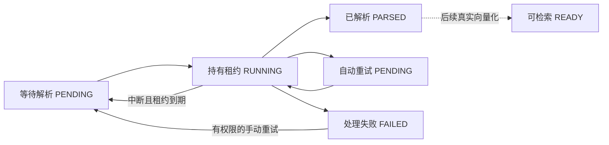

# 资料解析阶段验证记录

日期：2026-11-24。本阶段完成模型无关的文档解析和持久化任务执行，不接入 Embedding 或回答模型。

## 处理状态

PARSED 资料的正文分块已经存入数据库，但 `embedding_profile` 为空、`is_current=FALSE`。未来真实向量发布才能将资料改为 READY。SUCCEEDED 保留给完整索引流程完成，本阶段任务停在 PARSED。

## 实现与验证

| 项目 | 实测结果 |
| --- | --- |
| 状态迁移 | SeekDB 不支持同一个 ALTER 同时增删约束，改为先新增 v2 约束再删除旧约束；真实库连续执行两次成功，已有业务数据保留 |
| 任务领取 | 两个 worker 并发竞争同一任务，只有一个持有令牌，尝试次数只增加一次 |
| 租约与续期 | 租约未过期时可续期；过期令牌不能续期或写回 |
| 进程恢复 | 独立新 Python 进程接管数据库中已过期的任务并成功解析，不依赖原进程内存 |
| 失败次数 | 自动重试指数退避；多次中断或失败达到本轮上限后停止，资料显示失败 |
| 手动重试 | 校验当前正文版本、权限与预期重试轮次，旧请求不能重复开启新一轮 |
| 旧任务隔离 | 旧 worker 在新 worker 成功后回写失败或分块，均被拒绝；删除/替换期间的旧任务也不能发布 |
| 原子发布 | 模拟写入第一片段后异常，全部分块回滚，不出现部分可用正文 |
| 文件完整性 | 文件大小和哈希异常不会被默默解析，记录可解释的失败码 |
| 来源信息 | 片段连续编号，内容与规范化字符区间一致，保留页码和标题；非空字符覆盖测试通过 |
| 权限 | 他人与教师不能查看私人分块或重试私人任务；本人退课后可查看已有分块，但不能重试 |
| 超时 | 超过处理期限时拒绝发布片段；该机制不强制终止解析函数，不声称硬进程超时隔离 |

运行 `python -m pytest -q`：48 passed，包含前两阶段 32 项和本阶段 16 项。仍有一条 Starlette/httpx 测试客户端弃用提示。TypeScript 和 Vite 生产构建通过。

## 浏览器检查

真实 worker 处理了本地自行编写的演示笔记。页面显示“已解析 · 待向量化”和片段数量，打开“查看分块”后可见对应 Markdown 标题与正文。截图保存在忽略的 storage/qa，不包含真实用户资料，也不上传仓库。错误及重试的业务路径由接口和服务层测试验证，本次未声称所有浏览器重试交互均已走完。

## 已知边界

- 600 字符和 80 字符重叠是预处理规则，尚未按任何模型 tokenizer 验证；确定模型后可能重分块。
- 任务自动恢复依赖租约和 worker 重新运行，尚未配置操作系统服务监控；数据库不可用时 worker 可能退出，需要重启。
- 原文件的物理清理与留存周期、真正向量发布、RAG 和历史回答权限检查仍属于后续工作。
